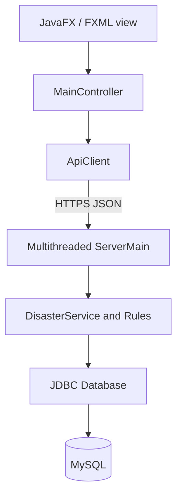
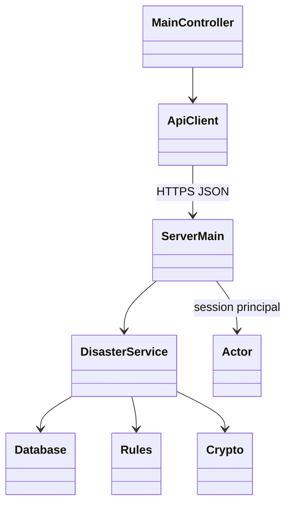
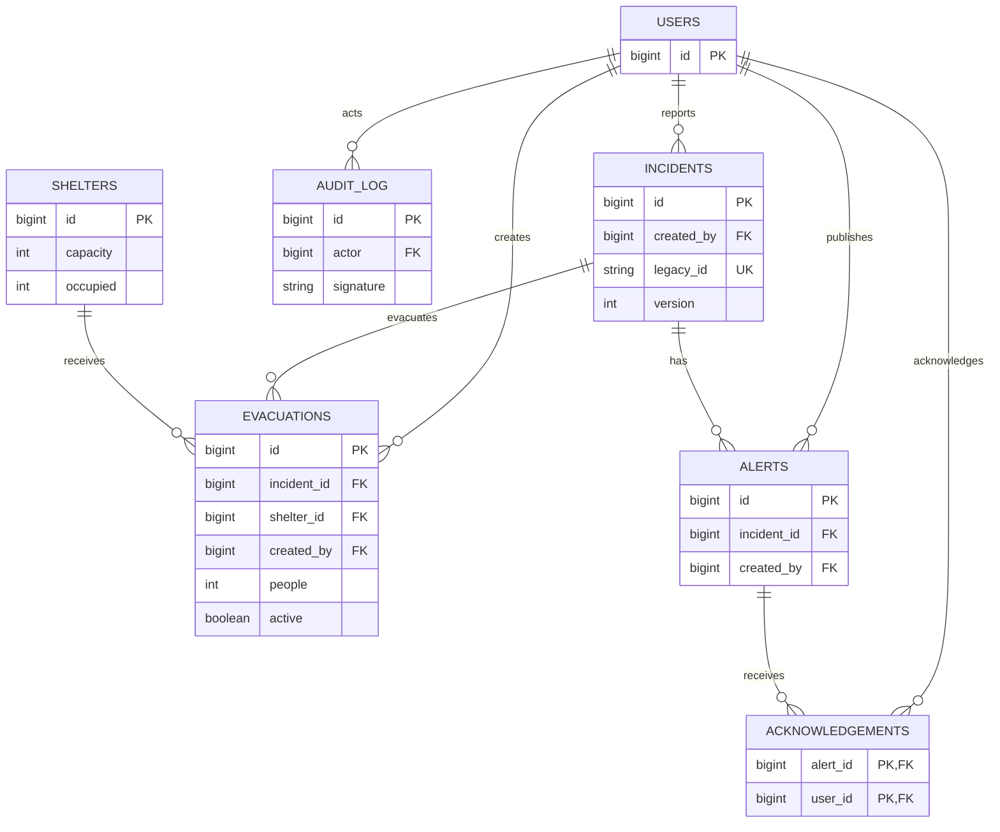
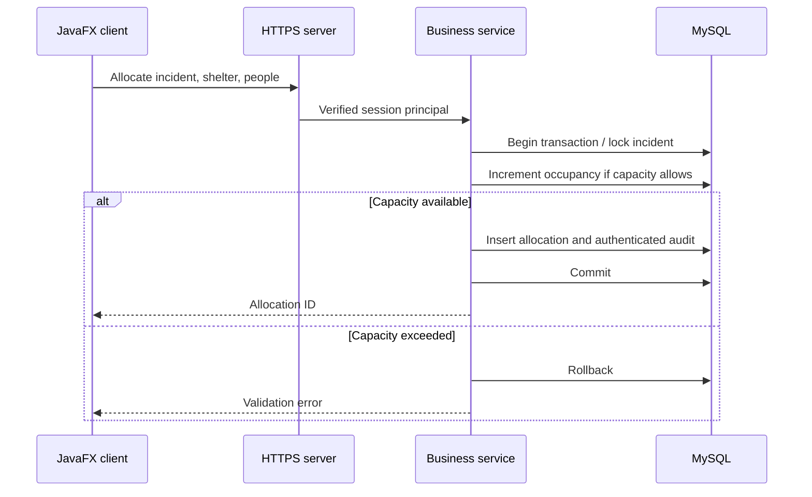

# DRS-Enhanced design

## Selection and continuity
Only one initial codebase was supplied. Its MVC JavaFX/FXML approach, incident fields,
assessment, allocation, monitoring, search and export make it a suitable starting point.
No comparison against unseen team prototypes is claimed. The enhanced project redesigns
its in-memory store and hardcoded login into server-side JDBC persistence and authenticated
HTTPS, retaining its domain workflows.

The initial project contains no saved incident dataset. Existing live incidents can be
exported from DRS-Initial, converted with scripts/convert_initial_exports.py and imported
using the enhanced GUI. All record fields are retained, including the legacy ID,
priority, status, departments and allocated resource. Database IDs are newly generated.
Sample JSON is explicitly demonstration data, not recovered student data.

## Three tiers / MVC
- View: JavaFX main.fxml, CSS and controller-created form controls. The FXML shell opens
  in Scene Builder; operational forms are built in MainController, so they are edited in Java.
- Controller: MainController dispatches asynchronous user actions to ApiClient.
- Model / middle tier: Rules, Actor and DisasterService validate permissions and domain rules.
- Persistence: Database uses parameterised JDBC statements and a connection per request.
- Transport: a bounded HttpsServer worker pool accepts JSON requests; no Java deserialization.

## Functional requirements
FR1 Login/logout and one-hour sessions. FR2 Validated disaster reporting and generated IDs.
FR3 Assessment and severity-derived response priority. FR4 Primary/supporting department
and resource descriptions. FR5 Controlled status transitions and incident closure.
FR6 Incident monitoring, text search/filter and text export. FR7 Admin account creation
and enable/disable. FR8 Atomic legacy import with duplicate detection.
FR9 NEW: shelter creation, capacity-checked evacuation allocation and release.
FR10 NEW: incident alerts with visibility restrictions and per-user acknowledgement.

## Nonfunctional requirements and limits
- HTTPS protects transport; PBKDF2-HMAC-SHA256 uses 210,000 iterations and random salts.
- AES-256-GCM encrypts descriptions and alert text. Other operational fields remain readable
  in the database. Access to them is controlled by roles and incident assignment.
- Timestamps and authenticated audit records support accountability. HMAC checks detect
  edited records, but do not detect deletion or provide independent, legal non-repudiation;
  the server key holder can forge a record. External signed/WORM logging is future work.
- Transactions cover evacuation capacity, import batches and all mutations; version checks
  prevent stale incident overwrites. Read-only database work uses the same transaction wrapper.
- GUI I/O is performed on one worker thread, with JavaFX updates on the application thread.
- This is a classroom prototype. No uptime SLA, live dispatch integration, SMS delivery,
  inventory stock accounting, or measured production load capacity is claimed.
- Alerts are internal records refreshed by the user, not push notifications or SMS.
- Resources are allocation descriptions, consistent with the original prototype.

## Roles
| Role | Scope |
|---|---|
| ADMIN | All incident workflows; users and audit integrity review |
| COORDINATOR | All incident workflows, shelters, alerts and import |
| REPORTER | Submit and view own incidents; acknowledge associated alerts |
| RESPONDER | View assigned department incidents; progress updates; associated alerts; shelters |

## Domain class relationships

## ERD

## Evacuation sequence

